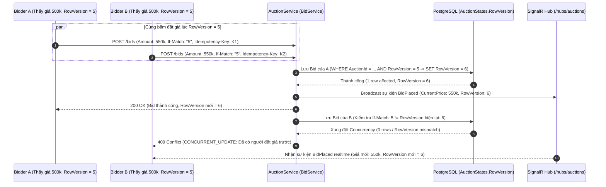

# TÀI LIỆU 02: LÝ GIẢI THIẾT KẾ NGHIỆP VỤ, CƠ SỞ SỐ LIỆU & CƠ CHẾ ĐẶT GIÁ REALTIME

> **Mục đích:** Giải thích rõ **"TẠI SAO (Why)"** hệ thống lựa chọn từng cơ chế nghiệp vụ, từng con số định lượng và kiến trúc kỹ thuật (Đặt cọc ví nội bộ, Giữ cọc Top 2, Chuỗi vi phạm Streak, Anti-Sniping, Concurrency Control với `RowVersion` / `If-Match`, Realtime với `SignalR`, và Cơ chế việc nền không dùng Outbox).

---

## 1. VÌ SAO CẦN ĐẶT CỌC & VÌ SAO DÙNG CƠ CHẾ KHÓA SỐ DƯ VÍ NỘI BỘ (DIRECTION C)?

### 1.1. Vì sao bắt buộc phải có Đặt cọc (Deposit) trước khi Đặt giá (Bid)?
Nếu cho phép người dùng đặt giá tự do không cần tiền cọc, sàn đấu giá sẽ đối mặt với 3 vấn nạn kinh điển:
1. **Spam Bid & Phá giá ảo (Troll Bidding)**: Kẻ xấu tạo hàng loạt tài khoản ảo vào đẩy giá sản phẩm lên cao ngất ngưởng rồi bỏ chạy, làm những người mua thật bỏ cuộc và khiến phiên đấu giá của Seller thất bại hoàn toàn.
2. **Shill Bidding (Quân xanh đẩy giá)**: Seller hoặc đồng phạm dùng tài khoản phụ vào nâng giá liên tục để ép người mua thật phải trả giá cao hơn giá trị thực, nếu lỡ tài khoản phụ thắng thì chỉ việc bỏ đơn không mất gì.
3. **Bùng kèo sau khi thắng (Non-payment Winner)**: Người thắng đổi ý không mua nữa làm sản phẩm của Seller bị giam tồn kho suốt nhiều ngày.

$\rightarrow$ **Giải pháp**: Bắt buộc khóa một khoản tiền cọc thực tế trước khi cho phép đặt giá. Khi người mua có "tiền thật đặt trên bàn" (*Skin in the game*), hành vi đặt giá trở nên có trách nhiệm và có nguồn tiền sẵn để bồi thường ngay cho Seller nếu người thắng bùng kèo.

### 1.2. Vì sao chọn Khóa số dư Ví Nexus nội bộ (Direction C) thay vì Hold qua Cổng thanh toán (Stripe/VNPay)?
Ban đầu hệ thống cân nhắc phương án Pre-authorization Hold qua cổng thanh toán bên ngoài, nhưng quyết định chuyển sang **Khóa số dư khả dụng trong Ví Nexus (`AvailableBalance = Balance - HeldBalance`)** vì 4 lý do cốt lõi:
1. **Không bị giới hạn thời gian Hold 7 ngày của cổng thanh toán**: Một phiên đấu giá kéo dài tối đa 7 ngày + 24h Winner thanh toán + 24h mời Người về nhì + 24h Người về nhì thanh toán + 24h Seller duyệt = **lên tới 11 ngày**. Các cổng thanh toán thẻ quốc tế thường tự động hủy lệnh Hold sau 7 ngày, gây rủi ro mất cọc trước khi phiên ngã ngũ. Khóa số dư trong ví nội bộ không bị giới hạn thời gian này.
2. **Không tốn phí giao dịch cổng (Gateway Fee) cho những người thua cuộc**: Một phiên đấu giá có thể có 50 người đặt cọc nhưng chỉ có 1 người thắng và 49 người thua được trả lại cọc. Nếu thu rồi hoàn qua cổng thanh toán ngoài, sàn hoặc người dùng sẽ phải chịu phí xử lý giao dịch rất lớn cho 49 lệnh hoàn tiền. Khóa/mở khóa bút toán nội bộ trong Ví Nexus có **chi phí bằng 0** và diễn ra **tức thì (đồng bộ 100%)**.
3. **Tại sao chỉ cần đặt cọc 1 lần theo Giá khởi điểm (không bắt đóng thêm khi nâng giá bid)?**
   - Nếu bắt người dùng nạp thêm cọc mỗi lần nâng giá trong những phút cuối (khi đang đua giá từng giây), người mua sẽ không kịp thao tác và làm đứt gãy trải nghiệm đấu giá realtime. Tính cọc một lần trên `StartPriceAmount` giúp Buyer sau khi khóa cọc xong có thể đặt giá mượt mà ngay lập tức.

---

## 2. VÌ SAO CHỌN CÁC CON SỐ ĐỊNH LƯỢNG ĐÓ? (CƠ SỞ PHÁP LÝ & ĐỐI SÁNH NGÀNH)

Mọi con số mặc định trong hệ thống không phải tự nghĩ ra ngẫu nhiên mà dựa trên **Luật Đấu giá tài sản Việt Nam**, **Chuẩn đối sánh các sàn TMĐT/Đấu giá lớn (Yahoo! Auctions, eBay, StockX, Shopee)** và **bài toán cân bằng kinh tế**. Đồng thời, các thông số chính sách đều được lưu trong bảng `AuctionConfigs` để Admin có thể điều chỉnh linh hoạt theo từng giai đoạn vận hành:

### 2.1. Khung tỷ lệ cọc `5% – 20%` (và trần `30%`)
- **Căn cứ pháp lý**: Theo **Điều 39 Luật Đấu giá tài sản Việt Nam (Luật số 01/2016/QH14, sửa đổi 2024)**, khoản tiền đặt trước khi tham gia đấu giá được quy định trong khung từ **tối thiểu 5% đến tối đa 20%** giá khởi điểm.
- **Áp dụng phân tầng theo Điểm uy tín (`ReputationScore` thang 0–100)**:
  - Thay vì áp một mức cọc cứng nhắc cho tất cả mọi người, hệ thống chia khung `5% – 20%` của Luật thành 4 bậc:
    - Uy tín cao (`80–100 điểm`) chỉ cần cọc mức sàn **5%** (khuyến khích người dùng tích lũy uy tín và giảm rào cản vốn).
    - Uy tín trung bình (`60–79` và `40–59`) cọc **10% – 15%**.
    - Uy tín thấp (`0–39`) hoặc **Tài khoản mới (`IsNewUser = true`)** phải chịu mức trần của khung chuẩn là **20%** (ngăn chặn việc tạo nick clone hàng loạt để vào phá giá).
  - Người đang có chuỗi vi phạm `Streak = 2` bị cộng thêm phụ thu rủi ro **+10%** (tối đa chạm trần **30%**) trước khi bị khóa quyền đấu giá ở `Streak = 3`.

### 2.2. Mức cọc tối thiểu `50,000 VNĐ` (`minDepositAmount`)
- **Bài toán đơn hàng giá trị nhỏ (Minimum Deterrence Threshold)**:
  - Với các sản phẩm có giá khởi điểm thấp (ví dụ `100,000 VNĐ`), nếu tính 5% thì tiền cọc chỉ là `5,000 VNĐ` — quá nhỏ, không đủ sức răn đe hành vi spam.
  - Con số **`50,000 VNĐ`** tương đương 1 lượt phí vận chuyển tiêu chuẩn nội địa (GHN) và bằng hạn mức giao dịch tối thiểu phổ biến của các ví điện tử tại Việt Nam: đủ nhỏ để người mua thật sẵn sàng đặt, nhưng đủ lớn để chặn đứng việc dùng nhiều tài khoản ảo spam.

### 2.3. Tỷ lệ chia tiền tịch thu cọc: `70% cho Seller – 30% cho Sàn (Platform)`
- **Vì sao Seller nhận phần lớn (`70%`)?** Khi người mua bùng kèo, Seller là người chịu thiệt hại trực tiếp: hàng bị khóa tồn kho nhiều ngày, mất cơ hội bán cho người khác và phải tổ chức đấu giá lại.
- **Vì sao không trả 100% cho Seller mà Sàn phải giữ lại `30%`? (Chống gian lận thông đồng / Anti-Collusion)**:
  - Nếu trả 100% tiền cọc tịch thu cho Seller, sẽ xuất hiện lỗ hổng nghiêm trọng: Seller tự lấy tài khoản phụ vào đặt cọc rồi cố tình bỏ kèo để rút tiền/rửa tiền miễn phí (không mất phí sàn), hoặc cố tình gây khó dễ để khách bỏ cọc nhằm ăn trọn 100%.
  - Việc sàn thu **30%** vừa bù đắp chi phí vận hành hạ tầng xử lý phiên thất bại, vừa triệt tiêu hoàn toàn động cơ Seller tự dùng nick phụ bỏ cọc (vì làm vậy Seller sẽ mất đứt 30% cho sàn).

### 2.4. Vì sao chỉ giữ cọc của **Top 2 (Winner + Người về nhì)** khi kết thúc phiên?
- Nếu mở khóa cho tất cả người thua ngay lúc phiên vừa kết thúc (`Ended`), thì khi Winner bùng kèo và hệ thống mời Người về nhì (`Second-Chance`), Người về nhì đã được trả lại cọc từ trước nên nếu họ bấm nhận lời mời rồi bùng kèo tiếp thì không còn cọc để phạt.
- Ngược lại, nếu giữ cọc của toàn bộ 50 người tham gia cho đến khi đơn hàng giao xong thì 48 người từ hạng 3 trở xuống bị giam tiền vô ích suốt nhiều ngày (trong khi quy tắc của sàn chỉ mời tối đa 1 người về nhì duy nhất).
- $\rightarrow$ **Giữ cọc của đúng Top 2 (Hạng 1 và Hạng 2)** và mở khóa ngay lập tức cho Hạng 3 trở xuống là lời giải tối ưu: **Bảo vệ thanh khoản ví cho số đông người thua cuộc, đồng thời giữ nguyên cam kết tài chính 100% cho cả Winner lẫn Người về nhì**.

---

## 3. VÌ SAO CẦN CHUỖI VI PHẠM (`VIOLATION STREAK`) BÊN CẠNH ĐIỂM UY TÍN?

### 3.1. Điểm uy tín (`ReputationScore`) và Chuỗi vi phạm (`ViolationStreak`) bổ trợ nhau như thế nào?
- **`ReputationScore` (0–100)**: Phản ánh **lịch sử tích lũy dài hạn** của người dùng trên toàn sàn. Một người dùng lâu năm đang có 95 điểm uy tín nếu bùng kèo 1 lần bị trừ 5 điểm thì vẫn còn 90 điểm (vẫn ở bậc uy tín cao nhất). Nếu chỉ dựa vào `ReputationScore`, một tài khoản điểm cao có thể liên tiếp phá 3–4 phiên đấu giá trong một tuần mà chưa bị chặn.
- **`ViolationStreak` (0, 1, 2, 3, 4+)**: Đo lường **hành vi vi phạm liên tiếp trong ngắn hạn**.
  - Áp dụng nguyên lý **Chế tài lũy tiến (Progressive Discipline & Three-Strikes Rule)**:
    - **Lần 1 (`Streak = 1`, trừ `5 điểm`)**: Có thể do sự cố quên thanh toán ngoài ý muốn $\rightarrow$ Mất cọc + Cảnh báo (`Warning`).
    - **Lần 2 liên tiếp (`Streak = 2`, trừ `10 điểm`)**: Có dấu hiệu tái phạm $\rightarrow$ Tăng tỷ lệ cọc thêm **+10%** (`DepositRateIncreased`).
    - **Lần 3 liên tiếp (`Streak = 3`, trừ `15 điểm`)**: Vi phạm có hệ thống ("Quá tam ba bận") $\rightarrow$ **Tạm khóa quyền đấu giá trong `7 ngày`** (`TempRestricted`). Thời hạn **7 ngày** được chọn để tương ứng đúng với thời lượng tối đa của 1 chu kỳ phiên đấu giá trên sàn (`168 giờ = 7 ngày`).
    - **Lần 4 liên tiếp (`Streak >= 4`, trừ `20 điểm`)**: Tổng điểm bị trừ qua 4 lần là $5 + 10 + 15 + 20 = 50$ điểm (kéo một tài khoản từ 100 điểm xuống thẳng mức sàn 50 điểm) $\rightarrow$ **Đình chỉ quyền đấu giá vô thời hạn (`Suspended`)**, bắt buộc Admin phải xét duyệt thủ công mới mở lại được.

### 3.2. Câu hỏi phản biện: "Ở `Streak = 3` đã bị cấm đấu giá rồi thì làm sao người dùng lên được `Streak = 4`?"
Có **2 kịch bản thực tế** làm một tài khoản tăng từ `Streak = 3` lên `Streak = 4`:
1. **Hết hạn tạm khóa 7 ngày của `Streak = 3` nhưng chưa xóa nợ Streak**:
   - Ở `Streak = 3`, người dùng chỉ bị khóa tạm thời **7 ngày** (`RestrictedUntil = now + 7 ngày`).
   - Khi qua 7 ngày, họ được mở lại quyền đặt cọc và đấu giá, **nhưng chỉ số `ViolationStreak` trong hồ sơ của họ VẪN ĐANG LÀ `3`** (hết hạn tạm khóa không tự động xóa `Streak` về `0`).
   - `Streak` chỉ được reset về `0` khi họ **thắng và thanh toán đúng hạn một phiên đấu giá mới** (gọi API 25 `auction-payments` — cơ chế "lập công chuộc tội"). Nếu vừa hết 7 ngày tạm khóa mà vào thắng phiên mới rồi lại bùng kèo tiếp $\rightarrow$ `Streak` tăng từ `3` lên **`4`** và bị khóa vĩnh viễn (`Suspended`)!
2. **Thắng song song nhiều phiên đấu giá cùng lúc (Concurrent Auctions)**:
   - Lúc đang ở `Streak = 2` (chưa bị cấm), Buyer đặt giá và thắng cùng lúc 2 phiên đấu giá A và B kết thúc gần nhau. Khi cả 2 đơn hàng A và B lần lượt quá hạn thanh toán 24h, đơn A đẩy `Streak` lên `3` và đơn B đẩy tiếp `Streak` lên **`4`**.

---

## 4. VÌ SAO CHỌN ANTI-SNIPING `5 PHÚT` (TỐI ĐA 10 LẦN) & CÁC HẠN `24 GIỜ`?

1. **Vì sao cần Anti-Sniping `5 phút` (tối đa 10 lần)?**
   - Trong đấu giá trực tuyến, nếu giờ đóng phiên là cố định tuyệt đối, người chơi sẽ dùng bot/tool canh đúng **1 giây cuối cùng** mới gửi lệnh đặt giá (*Bid Sniping*) để người khác không kịp phản ứng, làm Seller không bán được mức giá thực tế cao nhất mà thị trường sẵn sàng trả.
   - Cơ chế **Soft-Close / Popcorn Bidding** (chuẩn của *Yahoo! Auctions Japan*, *Sotheby's*, *Bring a Trailer*): Khi có lệnh đặt giá trong **5 phút cuối**, giờ kết thúc tự động lùi thêm **5 phút**.
   - **Tại sao là 5 phút?** Khoảng thời gian 5 phút vừa đủ để người bị vượt giá nhận thông báo (`Outbid`), mở ứng dụng, cân nhắc tài chính và gửi mức giá mới, nhưng không quá dài làm nguội sức nóng của phiên. Giới hạn tối đa **10 lần** (tối đa +50 phút) đảm bảo phiên đấu giá không bị kéo dài vô tận sang ngày hôm sau.
2. **Vì sao các thời hạn sau đấu giá (`PaymentWindow`, `SecondChanceWindow`, `SellerAcceptWindow`) đều là `24 giờ`?**
   - **Đảm bảo trọn vẹn 1 chu kỳ sinh hoạt ngày đêm (`24h`)**: Phiên đấu giá có thể kết thúc lúc nửa đêm hoặc khi người mua đang bận làm việc. Hạn 24 giờ đảm bảo người mua/người bán ở mọi khung giờ đều có đủ thời gian hoàn tất giao dịch.
   - **Giữ độ nóng cho Người về nhì**: Nếu để hạn thanh toán quá dài (như 48h–72h), khi Winner bỏ kèo thì tới lúc gửi lời mời cho Người về nhì đã trôi qua 3 ngày — lúc đó Người về nhì thường đã mua món hàng khác. Cửa sổ 24h giữ cho luồng chuyển giao Second-Chance diễn ra nhanh gọn khi nhu cầu mua của Người về nhì vẫn còn nguyên.

---

## 5. CÁCH VẬN HÀNH KỸ THUẬT CỦA LUỒNG ĐẶT GIÁ ĐỒNG THỜI & REALTIME (SIGNALR)

### 5.1. Tại sao tách biệt: Đặt giá qua REST (`POST /bids`) và Nhận cập nhật qua WebSocket (`SignalR`)?
- **Đặt giá (`POST /api/v1/auctions/{id}/bids`) dùng HTTP REST**:
  - Thao tác đặt giá là giao dịch ghi quan trọng, cần tận dụng đầy đủ hệ sinh thái chuẩn của HTTP: xác thực qua API Gateway, kiểm tra header chống bấm đúp `Idempotency-Key`, kiểm tra header chống xung đột phiên bản `If-Match` (`RowVersion`), và trả về mã trạng thái HTTP tường minh (`200`, `400`, `403`, `409`, `410`, `422`).
- **Cập nhật giao diện (`/hubs/auctions`) dùng SignalR (WebSocket)**:
  - Một phiên đấu giá đang nóng có thể có hàng trăm người cùng mở màn hình theo dõi. Nếu trình duyệt dùng cơ chế hỏi liên tục (HTTP Polling mỗi giây) sẽ gây quá tải server và vẫn bị trễ nhịp.
  - Với SignalR, khi người dùng mở trang chi tiết phiên đấu giá, trình duyệt kết nối tới Hub `/hubs/auctions` và gọi `JoinAuction(auctionId)` để vào phòng (`group`) `auction:{id}` (mỗi kết nối theo dõi tối đa 20 phiên).
  - Ngay sau khi `BidService.PlaceBidAsync` lưu lượt đặt giá mới vào Database thành công (`SaveChangesAsync`), server lập tức đẩy sự kiện **`BidPlaced`** qua SignalR xuống toàn bộ người dùng trong phòng `auction:{id}`. Giao diện tự động nhảy số tiền mới, giờ kết thúc mới (nếu có gia hạn Anti-Sniping) và cập nhật luôn `RowVersion` mới mà **không cần tải lại trang (F5)**.

### 5.2. Xử lý Nhiều người bấm Đặt giá cùng một thời điểm (Concurrency Control với `RowVersion` & `If-Match`)
Khi nhiều người dùng cùng nhìn thấy mức giá hiện tại là `500,000 VNĐ` (đang ở `RowVersion = 5`) và cùng bấm đặt giá ở cùng một thời điểm:

1. **Nguyên tắc xử lý**:
   - Không xếp hàng chờ (queue) gom các bid lại, mà dùng **Khóa lạc quan (Optimistic Concurrency)** thông qua cột `RowVersion` trên bảng `AuctionStates` kết hợp với header `If-Match`.
   - Khi trình duyệt tải chi tiết phiên đấu giá (hoặc nhận sự kiện `BidPlaced` qua SignalR), trình duyệt biết được `RowVersion` hiện hành của phiên (ví dụ `RowVersion = 5`).
   - Khi gửi lệnh đặt giá, trình duyệt bắt buộc đính kèm `If-Match: "5"`.
   - Người nào lưu xuống Database trước (Bidder A) sẽ làm `RowVersion` tăng lên `6`.
   - Người đến sau (Bidder B, vẫn gửi `If-Match: "5"`) sẽ bị chặn ngay bằng lỗi **`409 CONCURRENT_UPDATE`** (*"Đã có người khác vừa đặt giá trước bạn"*), kể cả khi Bidder B đặt số tiền cao hơn, vì quyết định đặt giá của Bidder B được đưa ra dựa trên trạng thái giá cũ.
   - Nhờ SignalR vừa đẩy `RowVersion = 6` và mức giá mới `550,000 VNĐ` xuống màn hình của Bidder B, Bidder B thấy ngay mức giá mới và có thể bấm đặt giá tiếp theo với `If-Match: "6"`.

2. **Chống bấm đúp / Mạng lag gửi lặp (`Idempotency-Key`)**:
   - Nếu người dùng bấm nút Đặt giá 2 lần liên tiếp hoặc mạng chập chờn tự động retry cùng một request: Nhờ header `Idempotency-Key`, `AuctionService` nhận diện key đã xử lý trong bảng `IdempotencyKeys`, lập tức trả về kết quả `PlaceBidResponse` đã lưu của lần đầu tiên mà không tạo bid thứ 2 và không bắn lại sự kiện SignalR.

---

## 6. VÌ SAO DÙNG CỘT TRẠNG THÁI VIỆC NỀN + JOB QUÉT 1 PHÚT (THAY CHO RABBITMQ / OUTBOX)?

Vì kiến trúc toàn hệ thống đã bãi bỏ hoàn toàn RabbitMQ/MassTransit để chuyển sang giao tiếp 100% RESTful HTTP, `AuctionService` giải quyết bài toán **Đảm bảo tính nhất quán liên dịch vụ (Eventual Consistency)** khi gọi sang `WalletService`, `UserService`, `CatalogService`, `CommerceService` bằng cơ chế **State-Column + Fast-Path + Periodic Retry Scanner**:

1. **Lưu trạng thái nghiệp vụ và "Việc cần làm" trong cùng 1 Database Transaction**:
   - Ví dụ khi phiên kết thúc hoặc nhận callback thanh toán, `AuctionService` đổi trạng thái phiên và bật các cờ việc nền (`AuctionDeposit.PendingAction = Release | Capture | Refund`, `Auction.ViolationState = Pending`, `Auction.StreakResetState = Pending`, `Auction.StockReleaseState = Pending`, `AuctionWinnerOffer.SettlementState = Pending`) trong **cùng một lệnh `SaveChangesAsync()`**.
2. **Gọi thử ngay lập tức sau khi Commit (`Fast-Path`)**:
   - Ngay sau khi `SaveChangesAsync()` thành công, `AuctionService` gọi HTTP sang service đích ngay lập tức. Trong 99% trường hợp khi mạng bình thường, việc đồng bộ hoàn tất ngay trong vài chục mili-giây và cột trạng thái chuyển sang `Done` / `None`.
3. **Job quét định kỳ mỗi 1 phút (`Background Retry Scanner`) phòng khi Service đích bảo trì hoặc mạng lỗi**:
   - Nếu lúc gọi `Fast-Path` mà service đích bị sập (`503`) hoặc `AuctionService` bị khởi động lại đột ngột, trạng thái `Pending` vẫn nằm an toàn trong PostgreSQL.
   - Mỗi 1 phút, `AuctionLifecycleWorker` quét các bản ghi `Pending` có `NextRetryAt <= now` và `NeedsAttention == false` để gọi lại bằng khóa Idempotent (`capture:{depositId}`, `release:{depositId}:{attempt}`, `refund:{depositId}`...).
   - Nếu vẫn lỗi, hệ thống giãn cách thời gian thử lại theo lịch **Exponential/Stepped Backoff: `1 phút -> 2 phút -> 5 phút -> 10 phút -> 30 phút`**.
   - Nếu quá **10 lần thử** vẫn thất bại, bản ghi được đánh dấu **`NeedsAttention = true`** kèm nội dung lỗi `LastError` để hiển thị cảnh báo trực tiếp cho Admin trên màn hình đối soát (API 13: `GET /api/v1/admin/auctions/{id}/deposits`).
