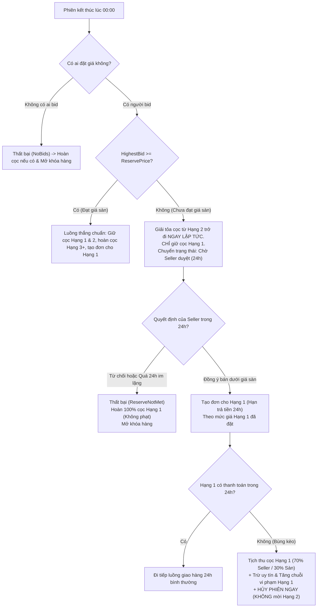

# TÀI LIỆU PHÂN TÍCH NGHIỆP VỤ: GIÁ SÀN (RESERVE PRICE) & LUỒNG DUYỆT BÁN DƯỚI GIÁ SÀN

> **Đối tượng đọc:** Product Owner / BA, Frontend (FE), Backend (BE), QA.  
> **Mục tiêu tài liệu:** Làm rõ bản chất và sự khác biệt giữa **Giá sàn** và **Giá khởi điểm**, lý do lựa chọn phương án **"Kết thúc tự nhiên + Hỏi ý kiến Seller trong 24h"** thay vì hủy sớm hay dùng tài khoản nội bộ, cùng hướng dẫn triển khai chi tiết cho BE và FE.  
> **Tài liệu liên quan:** [01_AUCTION_END_TO_END_FLOW.md](./01_AUCTION_END_TO_END_FLOW.md) • [03_BUY_NOW_BUSINESS_ANALYSIS.md](./03_BUY_NOW_BUSINESS_ANALYSIS.md)

---

## 1. Bối cảnh & Phân biệt Giá khởi điểm vs Giá sàn

### 1.1. Giá sàn khác gì Giá khởi điểm?
Nhiều người dễ nhầm hai khái niệm này, nhưng về mặt nghiệp vụ đấu giá, chúng đóng hai vai trò hoàn toàn khác nhau:

| Tiêu chí | Giá khởi điểm (`StartPrice`) | Giá sàn (`ReservePrice`) |
| :--- | :--- | :--- |
| **Bản chất** | Mức giá **mở màn** cho lượt trả giá đầu tiên. | Mức giá **tối thiểu bí mật** mà Seller chấp nhận bán. |
| **Mục đích** | Làm "cái phễu" thu hút đông người vào đặt cọc và trả giá sớm (ví dụ đặt thấp để tạo hiệu ứng đám đông). | Làm "lưới an toàn" giúp Seller không bị ép bán lỗ nếu phiên đấu giá ít người tham gia. |
| **Ai được biết con số?** | **Công khai** cho tất cả mọi người (Seller, Buyer, Admin). | **Bí mật:** Chỉ **Seller và Admin** biết con số cụ thể. **Buyer KHÔNG cần biết con số**, chỉ thấy trạng thái (*"Chưa đạt giá sàn"* / *"Đã đạt giá sàn"*). |

### 1.2. Tại sao Buyer KHÔNG được biết con số Giá sàn?
- Nếu Buyer biết trước con số Giá sàn (ví dụ `15 triệu`) trong khi Giá khởi điểm là `5 triệu`, họ sẽ mất hứng thú rượt đuổi từ `5 triệu` lên, hoặc nếu thấy giá sàn cao sẽ bỏ đi ngay từ đầu không thèm đóng cọc.
- Việc **ẩn con số, chỉ hiện trạng thái** giúp giữ kịch tính cho cuộc đấu giá, đồng thời đảm bảo tính minh bạch: Buyer luôn biết mức giá hiện tại đã đủ điều kiện chốt đơn hay chưa.

---

## 2. Quy tắc thiết lập giá khi Seller tạo phiên (Có bắt buộc nhập Giá sàn không?)

### 2.1. Tính bắt buộc của các mức giá
- **Giá khởi điểm (`StartPrice`):** **Bắt buộc** (tính làm gốc cho Bước giá và Tiền cọc).
- **Giá Mua ngay (`BuyNowPrice`):** **Không bắt buộc (Optional)**. Seller có quyền nhập hoặc bỏ trống nếu chỉ muốn đấu giá thuần túy.
- **Giá sàn (`ReservePrice`):** **Khuyến nghị là Không bắt buộc (Optional — Nếu bỏ trống thì hệ thống mặc định hiểu phiên không dùng giá sàn riêng, tức là chỉ cần `>= StartPrice` là bán).**
  - *Lý do:* Nếu Seller muốn bán kiểu *"tôi đặt Giá khởi điểm `15 triệu`, ai trả đúng `15 triệu` là bán luôn không cần giấu giá sàn"*, việc ép họ phải nhập thêm một con số Giá sàn lớn hơn nữa sẽ gây thừa thãi và khó chịu về trải nghiệm.
  - *Lưu ý liên kết với Buy Now:*
    - Nếu phiên **CÓ cài Giá sàn (`ReservePrice > StartPrice`)**: Nút Buy Now ẩn khi `CurrentBid >= ReservePrice`.
    - Nếu phiên **KHÔNG cài Giá sàn riêng**: Nút Buy Now ẩn ngay khi **có lượt bid đầu tiên** (giống chuẩn eBay cho phiên không có giá sàn).

### 2.2. Ràng buộc quan hệ giữa 3 mức giá (Validation)
Nếu Seller có nhập các thông số tương ứng, hệ thống bắt buộc kiểm tra:
$$\text{StartPrice} \le \text{ReservePrice} < \text{BuyNowPrice}$$
*(Trong đó khuyến nghị `BuyNowPrice` lớn hơn `ReservePrice` tối thiểu 1 bước giá để nút Mua ngay có ý nghĩa).*

---

## 3. Phân tích giải pháp xử lý khi phiên hết giờ nhưng CHƯA ĐẠT GIÁ SÀN

### 3.1. Vì sao KHÔNG chọn 2 cách: "Force-cancel sớm" và "Dùng Account nội bộ vào bid"?

Trước khi chốt phương án, team đã cân nhắc 2 cách thường được nhắc đến nhưng đều loại bỏ vì các rủi ro nghiêm trọng sau:

| Phương án đã loại bỏ | Bản chất | Lý do KHÔNG chọn trên sàn Nexus |
| :--- | :--- | :--- |
| **Cách 1: Dùng `force-cancel` của Admin khi thấy sắp hết giờ mà chưa đạt sàn** | Chủ động hủy phiên trước khi hết giờ nếu giá còn thấp hơn sàn. | 1. **Giết chết lượt bid phút chót:** Thực tế 70–80% lượt bid quyết định diễn ra ở 1–5 phút cuối (kèm luật gia hạn 5 phút). Hủy sớm làm mất cơ hội đạt giá sàn. 2. **Sai ngữ nghĩa dữ liệu:** `Admin force-cancel` mang nghĩa phiên bị cưỡng chế hủy do hàng giả/vi phạm. Dùng cho thiếu giá gây hiểu nhầm nghiêm trọng. 3. **Rủi ro canh giờ:** Chạy sớm mất khách, chạy trễ 1 giây phiên đã tự chốt dưới giá sàn. |
| **Cách 2: Dùng Account nội bộ ("quân xanh") vào bid bằng giá sàn** | Cho tài khoản nội bộ vào đặt giá đúng bằng `ReservePrice` nếu sắp hết giờ chưa đạt sàn. | 1. **Vi phạm tính minh bạch (Shill Bidding / Thổi giá):** Trên sàn TMĐT trực tuyến, việc hệ thống/chủ sàn tự dùng acc ảo vào đẩy giá bị coi là gian lận, làm mất niềm tin hoàn toàn. 2. **Xung đột nặng với code Ví & Cọc:** Acc nội bộ muốn bid phải khóa tiền cọc thật trong Ví Nexus; nếu tự thắng sẽ sinh đơn hàng, không trả tiền sẽ bị tịch thu cọc 70/30, trừ uy tín, tăng chuỗi vi phạm và lại mời nhầm Người về nhì (vốn đặt dưới sàn). Phải viết quá nhiều code ngoại lệ để xóa dấu vết. |

### 3.2. Giải pháp được chọn: Kết thúc tự nhiên + Cho Seller quyết định trong 24h (`PendingSellerDecision`)

Thay vì can thiệp thô bạo trước khi hết giờ, hệ thống để phiên chạy tự nhiên tới **đúng giây `00:00`** (vẫn áp dụng gia hạn chống bắn tỉa nếu có bid cuối giờ), sau đó phân nhánh minh bạch:

### 3.3. Tại sao giải pháp này là tối ưu nhất?
1. **Giữ trọn vẹn cơ hội phút chót:** Người mua được đấu giá sòng phẳng tới giây cuối cùng.
2. **Tăng tỷ lệ chốt đơn thực tế:** Nhiều Seller đặt sàn `15 triệu`, nhưng khi thấy phiên chỉ đạt `14 triệu` vẫn sẵn sàng gật đầu bán luôn để khỏi mất công đăng lại.
3. **Không mời Hạng 2 khi Hạng 1 bùng kèo dưới giá sàn:** Vì giá Hạng 1 vốn đã là mức dưới sàn mà Seller phải nhượng bộ mới bán, giá của Hạng 2 còn thấp hơn nữa nên không tự động mời Hạng 2 (tránh rắc rối hỏi ý kiến Seller nhiều lần). Do đó **cọc của Hạng 2 trở xuống được trả ngay từ phút `00:00`**.
4. **Sạch sẽ về pháp lý & code:** Tuyệt đối không có tài khoản ảo, không phá vỡ logic Ví/Cọc hiện tại.

---

## 4. Hướng dẫn triển khai cho Frontend (FE)

### 4.1. Màn hình Tạo phiên đấu giá (Phía Seller)
- Trường **Giá sàn (`ReservePrice`)**: Để dạng nhập **tùy chọn (Optional)** kèm giải thích ngắn (tooltip): *"Mức giá tối thiểu bí mật bạn đồng ý bán (chỉ bạn và Admin thấy). Nếu hết giờ giá chưa đạt mức này, bạn có quyền quyết định bán hay không. Bỏ trống nếu bán theo giá khởi điểm."*
- Trường **Giá Mua ngay (`BuyNowPrice`)**: Để dạng nhập **tùy chọn (Optional)**.
- **Validate ngay trên form:**
  - Nếu có nhập Giá sàn: `ReservePrice >= StartPrice`.
  - Nếu có nhập Mua ngay: `BuyNowPrice > ReservePrice` (hoặc `> StartPrice` nếu không nhập Giá sàn).

### 4.2. Màn hình Chi tiết phiên đấu giá (Phía Buyer)
- **TUYỆT ĐỐI KHÔNG hiển thị con số `ReservePrice`** (API trả về cho Buyer chỉ cần trả cờ `isReserveMet: true/false`, không trả số tiền `ReservePrice`).
- **Hiển thị nhãn trạng thái rõ ràng ngay cạnh giá hiện tại:**
  - Khi `isReserveMet == false`: Hiện badge màu cam/vàng nhẹ: **`Chưa đạt giá sàn`** (kèm tooltip nhỏ: *"Mức giá hiện tại chưa đạt kỳ vọng tối thiểu của người bán"*).
  - Khi `isReserveMet == true`: Đổi sang badge xanh lá: **`Đã đạt giá sàn`** (và đồng thời **ẩn nút Buy Now** nếu đang có).
- **Khi phiên hết giờ mà `isReserveMet == false`:**
  - Với **Hạng 1**: Hiển thị thông báo trạng thái *"Phiên đã kết thúc (Chưa đạt giá sàn) — Đang chờ Người bán xác nhận trong 24h. Tiền cọc của bạn vẫn đang được tạm giữ và sẽ hoàn lại 100% nếu Người bán từ chối."*
  - Với **Hạng 2 trở đi**: Hiển thị *"Phiên đã kết thúc (Chưa đạt giá sàn). Tiền cọc của bạn đã được mở khóa hoàn trả về Ví."*

### 4.3. Màn hình Quản lý phiên của Seller (Khi rơi vào trạng thái `PendingSellerDecision`)
- Hiển thị nổi bật đồng hồ đếm ngược **24 giờ** kèm thông tin:
  - Giá sàn bạn đặt: `15.000.000 đ`
  - Giá cao nhất phiên đạt được: `14.000.000 đ`
- Cung cấp 2 nút hành động rõ ràng:
  1. **[Đồng ý bán với giá 14.000.000 đ]** $\rightarrow$ Popup xác nhận tạo đơn hàng cho người thắng.
  2. **[Từ chối bán & Đóng phiên]** $\rightarrow$ Popup xác nhận hủy phiên, hoàn cọc cho người mua và mở khóa sản phẩm.
- Nhắc nhẹ trên UI: *"Nếu bạn không phản hồi trong 24 giờ, phiên sẽ tự động hủy và hoàn cọc cho người mua."*

---

## 5. Biện pháp chống Seller lạm dụng đặt Giá sàn quá cao rồi liên tục từ chối bán

Việc cho phép Seller đặt Giá sàn là quyền hợp pháp để bảo vệ Seller khỏi bán lỗ, nên **không trừ uy tín ngay ở lần từ chối đầu tiên**. Tuy nhiên, để tránh tình trạng Seller lạm dụng (đặt Giá sàn trên trời để "dò giá" thị trường rồi phiên nào cũng hủy không bán, gây mất thời gian cho sàn và ức chế cho Buyer đã đóng cọc), cần áp dụng **3 lớp kiểm soát**:

1. **Giới hạn quyền đặt Giá sàn nếu từ chối liên tiếp:**
   - Nếu Seller từ chối bán dưới Giá sàn (hoặc để hết hạn 24h) **liên tiếp quá `N` lần** (ví dụ: 3 phiên liên tiếp hoặc tỷ lệ `ReserveNotMet` > 50% trong 30 ngày):
   - Hệ thống **tạm khóa quyền đặt `ReservePrice` trong `X` ngày** (ví dụ 14 ngày) — trong thời gian này, Seller muốn mở phiên mới **bắt buộc phải đấu giá không giá sàn** (ai trả cao nhất từ `StartPrice` trở lên là bán luôn).
2. **Chặn biên độ chênh lệch quá vô lý khi tạo phiên:**
   - Tránh trường hợp Seller đặt `StartPrice = 100.000 đ` nhưng đặt `ReservePrice = 100.000.000 đ` (gây hiểu nhầm câu kéo). Nên giới hạn `ReservePrice` không vượt quá một hệ số hợp lý so với `StartPrice` (hoặc so với giá tham khảo sản phẩm).
3. **Minh bạch tỷ lệ thành công của Seller (`SuccessRate`) cho Buyer:**
   - Khi một phiên kết thúc thất bại do `ReserveNotMet`, phiên đó vẫn được tính vào tổng số phiên thất bại trong **thống kê Seller** (`GET /api/v1/sellers/{sellerId}/auction-statistics` — đã có sẵn).
   - Hiển thị rõ `SuccessRate` trên trang phiên đấu giá để Buyer nhận biết các Seller có tỷ lệ chốt đơn thấp và cân nhắc trước khi đóng cọc.
